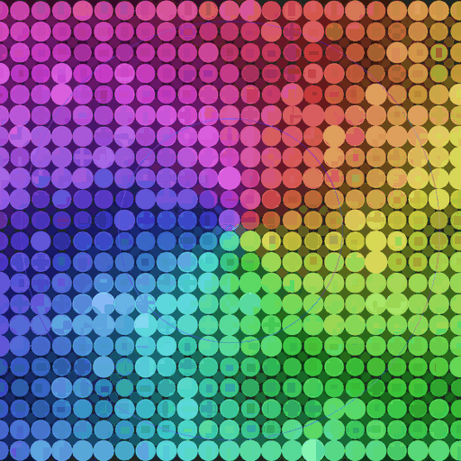

# Hex Grid Audio Reactive

一款基于 Canvas 的 **Wallpaper Engine 音频响应壁纸**：网格随音乐的低频、中频、高频起伏、变色、扩散波纹，支持 10 种动画预设 × 10 种配色共 100 种组合。零依赖，单文件 HTML。

<p align="center">
  
</p>

<p align="center">
  <sub>动态演示 · 512×512 · 20 帧 · 2.4 秒循环 · 默认「同心波 + 幻彩霓虹」</sub>
</p>

> **命名说明**：项目名沿用 `Hex Grid`，但实际绘制的是圆角方块／圆点网格（见 `index.html` 中的 `roundRect`），并非六边形。

---

## 效果特性

- **真实音频响应**：通过 Wallpaper Engine 的 `wallpaperRegisterAudioListener` 读取 128 段频谱，合并左右声道后拆分为低频 / 中频 / 高频三路驱动画面。
- **自动增益**：音量小自动放大、音量大自动回缩，不必针对不同音源反复调灵敏度。
- **鼓点检测**：低频突增时从屏幕中心扩散波纹并产生轻微震屏。
- **100 种组合**：10 种动画预设 × 10 种颜色预设，在 Wallpaper Engine 属性栏随时切换。
- **点击交互**：可开启点击波纹、点击全屏脉冲。
- **自适应**：随窗口尺寸重建网格，限制 DPR；移动端自动降低格子密度与发光开销。
- **零依赖**：没有外部 JS / 图片 / 字体请求，全部资源本地化，离线可用。

---

## 使用方法

### 方式 A：在 Wallpaper Engine 中使用（可响应真实声音）

1. 准备文件（任选其一）：

   ```bash
   git clone https://github.com/eutleek/hex-grid-audio-reactive.git
   ```

   或直接下载本仓库 ZIP 并解压。

2. 把**整个文件夹**（含 `index.html`、`project.json`、`preview.gif`）放到 Wallpaper Engine 的自定义项目目录：

   ```
   <Steam>\steamapps\common\wallpaper_engine\projects\myprojects\
   ```

   Windows 常见位置是 `C:\Program Files (x86)\Steam\steamapps\common\wallpaper_engine\projects\myprojects\`。

3. 重启 Wallpaper Engine，在「已安装」列表里找到它，双击即可应用。

   > 备选导入方式：打开壁纸编辑器 →「创建壁纸 / Create Wallpaper」→ 把 `index.html` 拖进去。按 Wallpaper Engine 官方文档，这会**复制一份**到 `myprojects` 并生成 `project.json`；本仓库已自带 `project.json`（含全部中文属性项），建议直接采用第 2 步的放置方式。

4. 播放任意音乐，在右侧「属性」栏调节动画、配色、灵敏度与交互开关。

项目配置里已开启 `supportsaudioprocessing`，Wallpaper Engine 会向壁纸推送系统音频频谱；**不需要任何麦克风权限或额外软件**。

### 方式 B：浏览器直接预览（无需 Wallpaper Engine）

双击 `index.html` 即可看到动画。浏览器里不存在 `wallpaperRegisterAudioListener`，代码会自动切换到**内置模拟节拍**（`simulateAudio`），因此：

- 能看到完整的动画与配色效果，可以直接改 `props` 里的默认值来试不同预设；
- **不会响应真实音乐**，要看音频联动请用方式 A。

---

## 可调参数

在 Wallpaper Engine 右侧属性栏调整，定义位于 `project.json` 的 `general.properties`。

| 属性 | 类型 | 默认值 | 说明 |
| --- | --- | --- | --- |
| 动画预设 `animPreset` | 下拉 | `concentric` | 见下方 10 种动画 |
| 颜色预设 `colorPreset` | 下拉 | `neon` | 见下方 10 种配色 |
| 灵敏度 `sensitivity` | 滑块 1–10 | `2` | 每档 0.5×：1→0.5×，2→1.0×，10→5.0× |
| 点击交互 `tapEnabled` | 开关 | 开 | 总开关，关闭后点击无效 |
| 点击波纹 `tapRipple` | 开关 | 关 | 在点击处生成扩散圆环 |
| 点击脉冲 `tapPulse` | 开关 | 关 | 触发一次全屏亮度脉冲 |
| 主题色 `schemecolor` | 颜色 | `0 0 0` | Wallpaper Engine 内置项 |

### 10 种动画预设

| 值 | 名称 | 效果 |
| --- | --- | --- |
| `concentric` | 同心波 | 从中心向外扩散的圆环波（默认） |
| `matrix` | 矩阵雨 | 每列独立下落的光带 |
| `twinkle` | 星光闪烁 | 高频随机闪烁，跟随高音 |
| `cross` | 十字脉冲 | 沿上下左右扩散的十字光波 |
| `explode` | 脉冲爆发 | 中心向外的剧烈爆发 |
| `breathe` | 呼吸节拍 | 全屏随重拍同步呼吸缩放 |
| `diagonal` | 对角流光 | 斜向光带反复扫过 |
| `bars` | 竖频谱条 | 每列映射一个频段，随频率起伏 |
| `radial` | 放射风暴 | 从中心旋转放射的辐条 |
| `chase` | 追逐波 | 逐行推进的光脉冲 |

### 10 种颜色预设

| 值 | 名称 | 效果 |
| --- | --- | --- |
| `neon` | 幻彩霓虹 | 全光谱流动（默认） |
| `cyber` | 赛博青橙 | 青蓝基底，重音偏橙 |
| `aurora` | 深海极光 | 绿→青→蓝→紫慢渐变 |
| `lava` | 熔岩炽焰 | 红→橙→黄 |
| `sakura` | 樱花幻紫 | 低饱和粉紫 |
| `synth` | 蒸汽波 | 紫粉主色 + 青色点缀 |
| `mint` | 薄荷冰蓝 | 清爽冷色调 |
| `sunset` | 日落黄昏 | 中心橙红、外围紫粉 |
| `emerald` | 翡翠极夜 | 深翠绿 + 墨色暗场 |
| `mono` | 白金 | 黑白银单色，极简 |

---

## 文件结构

```
Hex Grid Audio Reactive/
├── index.html      # 全部渲染与音频逻辑（Canvas 2D，约 580 行）
├── project.json    # Wallpaper Engine 项目配置与用户属性定义
├── preview.gif     # 动态演示图，同时作为 Wallpaper Engine 缩略图
├── README.md       # 本说明
└── .gitignore
```

---

## 实现要点

- **频谱处理**：128 段原始数据 → 左右声道取最大合并为 64 段 → 低 / 中 / 高频求均值；攻击系数 `0.8`、释放 `0.05`，配极低噪声门限，鼓点跟得上又不会碎闪。
- **自动增益**：`autoGain = clamp(0.3 / (loudnessSmooth + 0.04), 1, 8)`，再乘以灵敏度，避免安静音源几乎不动、大声音源又过曝。
- **起音检测**：`bassDelta > 0.02` 且冷却结束时生成中心波纹并叠加衰减震屏。
- **发光**：用双层半透明 `roundRect` 叠加模拟辉光，而不是 `shadowBlur`，大幅降低每帧开销；移动端提高发光阈值进一步省电。
- **颜色**：全部以 HSL 计算，配色预设只改色相映射与饱和度／亮度曲线，动画预设只改波形函数，两者互相独立。
- **浏览器回退**：`listenerExists` 为假时走 `simulateAudio()`，方便不上 WE 也能调试画面。

想改预设默认值，编辑 `index.html` 中的 `props` 对象；想改属性栏里的选项文字或默认值，编辑 `project.json`。

---

## 常见问题

**画面不动 / 没反应？**
浏览器中只有模拟动画；在 Wallpaper Engine 里请确认播放着音乐，且壁纸属性中音频处理处于启用状态。静音超过 2 秒（代码里的 `AUDIO_TIMEOUT`）会归零，属正常。

**太闪或太暗？**
把「灵敏度」往低调；也可换成 `mono`、`mint` 这类低饱和配色。

**名字是 Hex Grid，怎么看到的是圆点？**
历史命名，实际是圆角方块网格。要真六边形需要改 `index.html` 中格子的绘制与排布方式。

**`project.json` 里的 `"visibility": "private"` 是什么？**
Wallpaper Engine 的项目可见性字段，与 GitHub 仓库是否公开无关。

---

## 许可证

本仓库暂未附带 LICENSE 文件，许可条款待作者确定。个人使用、修改与本地运行不受限制；若要二次分发或发布到 Steam 创意工坊，请先与作者确认。
